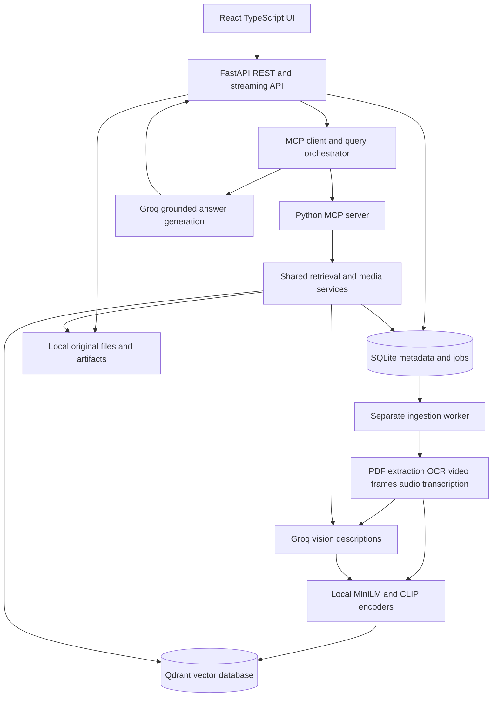

# Multimodal RAG Assistant System Design

Version: 1.1  
Date: 24 November 2026  
Status: Local MVP implemented; broader target architecture remains planned. See README.md for the implemented scope and run commands.

Current citation behavior: generate claim-level evidence references and assign source numbers in the backend. Per the user's updated preference, missing/malformed references do not block the answer: omit invalid links, retain usable text with a verification note, and mark the response partially answered. Actual unknown sources are never linked. This supersedes stricter citation-error behavior described in the original target design.

## Delivery scope for the 30 minute build

**This section governs the initial implementation. Sections 1–10 below describe the fuller target architecture; where they require more infrastructure or features, defer them as specified here.** The time budget is a delivery target, not a guarantee: first-time model downloads, dependency installation, and account access can consume it. Start the clock when implementation begins and report blockers rather than claiming unfinished requirements are complete.

### Required demo slice

- React upload/library/chat screen with concise/detailed and answer-language preferences; source links beneath answers.
- FastAPI backend handling text PDFs, TXT/pasted text, images, and short videos. Initial limits: 10 MB PDF/TXT, 5 MB image, 50 MB video, two-minute video duration, and six sampled frames. These replace the larger target limits for this build.
- PDF page text through pypdf; image and frame descriptions through Groq vision; tokenize and embed all extracted text and descriptions with local MiniLM. Retain original files and exact page/frame locators.
- **Hybrid RAG from the first working chat:** dense semantic retrieval plus keyword retrieval, fused before context selection. Image/video descriptions participate in both channels, allowing a question to retrieve evidence across formats.
- Persistent local Qdrant vector database in embedded mode, owned by one backend process, plus SQLite metadata and FTS5 keyword index. Use one Uvicorn worker and serialized vector-store access; never open the same embedded directory in an MCP subprocess. This replaces the target's standalone Qdrant server for the time-boxed demo.
- Mount a real MCP server in the FastAPI process using the SDK's supported Streamable HTTP integration. The backend MCP client connects through localhost with a shared application lifespan and discovers/calls all three required tools. Both REST and MCP handlers share the same storage service instance. This replaces the separate stdio MCP subprocess for the demo; verify the SDK integration early.
- Simple deterministic routing: search for every collection question, inspect the highest-ranked relevant image/frame when visual evidence is needed, and retrieve timestamped frames for video questions. Generate answers from the returned evidence, validate citation IDs, and abstain when evidence is insufficient.
- In-process background ingestion with SQLite status and a concurrency limit of one. Mark interrupted jobs failed on restart and allow manual reupload/retry. A durable worker queue is deferred; do not imply crash-safe background execution.

### Explicit hybrid retrieval contract

1. Produce identical evidence units and stable IDs in the dense and keyword indexes: PDF/text chunks, image descriptions, and video-frame descriptions. Apply selected-asset filters in both channels **before** selecting candidates.
2. Encode the question using MiniLM and fetch up to 15 cosine-ranked candidates from Qdrant.
3. Search SQLite FTS5 for up to 15 BM25-ranked candidates. Safely tokenize/quote user text for MATCH; raw questions must not become FTS query syntax. Omit an empty channel rather than failing the whole query.
4. Fuse by evidence ID using reciprocal rank fusion: `score(d) = sum(1 / (60 + rank_channel(d)))`, with ranks starting at 1 and absent-channel contributions equal to zero. Use equal channel weights initially. Do not add raw cosine and BM25 scores; their scales differ.
5. Deduplicate overlap and select up to six evidence units within the actual provider token budget. For a relevant PDF chunk, optionally include its immediate same-page neighbor; for a relevant frame, preserve the exact timestamp and frame artifact. Expansion must use the same selected-source scope and consume the same context budget.
6. Inspect original visual artifacts before asserting fine details. Treat generated descriptions as retrieval aids, not independently verified facts. Preserve source IDs through fusion, expansion, inspection, and final answer generation.
7. Decide whether evidence actually answers the question. RRF produces a ranking even for irrelevant candidates; its score is not an answerability threshold or confidence percentage. Return no-evidence or partial-answer status when appropriate.

Semantic retrieval helps with paraphrases such as “cost” versus “price”; BM25 helps with exact names, codes, and numbers. Combining them improves coverage opportunities but must be evaluated on our fixtures rather than assumed to improve every question. No cross-encoder reranker, query expansion model, or extra embedding API is required for this slice.

### Deferred after the demo

CLIP visual vectors and image-to-image search; local Tesseract OCR and scanned-PDF support; Whisper audio transcription; scene detection and adaptive frame resampling; DOCX/spreadsheets; multilingual retrieval; SSE streaming; Alembic; separate durable workers; authentication; deployment; and extensive evaluation tooling. Basic English retrieval and preference-based answer translation remain in scope. Video answers cover sampled visible content only; questions about speech must explicitly report that audio has not been indexed. This is a demo limitation, not full audiovisual coverage.

### Time allocation and completion gate

1. **Minutes 0–5:** environment loading, Groq text/image smoke tests, dependency/model download, FastAPI/React skeleton, and MCP initialization/discovery spike.
2. **Minutes 5–12:** PDF/text extraction, chunking, persistent Qdrant + SQLite FTS5, hybrid retrieval, grounded chat, and page citations.
3. **Minutes 12–18:** image description ingestion, six timestamped video frames, descriptions, and the three working MCP tool implementations.
4. **Minutes 18–25:** React upload/status/chat workflow, response preferences, source previews, video timestamp seeking, and error states.
5. **Minutes 25–30:** frontend build, backend smoke checks, real MCP calls, and one end-to-end question each for PDF, image, video, and unsupported content. Add a paraphrase and an exact identifier query to exercise both retrieval channels. Confirm asset filtering before fusion and that all returned citations resolve.

The demo is ready only when all required formats and MCP calls work end to end. If installation or model access blocks the budget, identify exactly what is working and what remains; do not silently drop hybrid retrieval or rename a REST function as MCP. The broader evaluation targets in section 9 are follow-up goals rather than claims about the 30-minute demo.

### Local environment and project conventions

Load the repository-root `.env` explicitly in backend configuration; launch ingestion and MCP through the same configured application. `GROQ_API_KEY` stays backend-only and must never use a `VITE_` prefix. `.env.example` contains empty placeholders; `.env`, data, and caches are ignored by Git. Never print the key in health checks, errors, or test output.

No repository or ancestor AGENTS.md or project rule files were found during this revision. Apply the session's existing instructions and relevant installed skills. Additional “regular rules and skills” were mentioned but not supplied; incorporate them when provided rather than inventing project conventions.

## 1. Objective and scope

Build a React and FastAPI assistant that accepts PDFs, images, videos, pasted text, and text questions; retrieves evidence from the uploaded collection; and returns answers with verifiable sources. Users can choose response language, detail, style, and source scope.

The initial deployment is a local, single-user assignment demo. External generation uses the Groq free tier; extraction, embeddings, transcription, storage, and retrieval run locally. No paid API or hosted database is required. Local computation still needs disk, memory, and processing time.

Supported MVP formats: PDF, TXT, PNG, JPEG, WebP, MP4, MOV, and WebM, subject to installed codecs. “All inputs” means these explicit supported formats, not every possible file extension. DOCX, spreadsheets, standalone audio uploads, and native full-video model input are future extensions. Videos are analyzed through sampled frames and timestamped audio transcripts; brief events between sampled frames may be missed.

## 2. Provider and model decisions

### Hosted generation

Use Groq's OpenAI-compatible chat API:

- Base URL: `https://api.groq.com/openai/v1`
- Operation: `POST /chat/completions`
- Primary configurable model: `qwen/qwen3.8-27b`
- Uses: image/frame descriptions, visual question answering, and final grounded text answers.
- Authentication: `GROQ_API_KEY`, held only by backend and worker processes.

Groq currently documents this model for text and image input, tool use, and JSON mode. The vision guide currently allows at most three images per request. Batch visual inspection accordingly and resize images before sending. This is an image-based video pipeline; do not send a video file to the chat endpoint. [Groq vision documentation](https://console.groq.com/docs/vision)

Groq offers a Free tier. Actual model access and organization quotas must be checked in the user's console and with a small authenticated text/image smoke test before building around the model. Published limits can change; a large context window does not imply that the free plan permits equally large requests. Configure token and image budgets from actual account limits. [Billing FAQ](https://console.groq.com/docs/billing-faqs), [rate limits](https://console.groq.com/docs/rate-limits)

Authenticated account/model discovery, image analysis, and grounded text/image/video answers were verified during the local MVP build. Future account access and quotas can still change. If unavailable, select another Groq vision model explicitly documented and accessible at implementation time; do not silently substitute a text-only model for vision.

### Local models from Hugging Face

Implementation note: the MVP uses FastEmbed's ONNX distribution of MiniLM with the same 384-dimensional semantic retrieval design, avoiding the larger PyTorch dependency. CLIP and Whisper below remain deferred.

- Text embeddings: `sentence-transformers/all-MiniLM-L6-v2`, normalized 384-dimensional vectors. This is an English-first retrieval baseline. Keep chunks within its 256 wordpiece limit, initially approximately 180 tokens with 30-token overlap, measuring with the model tokenizer. [Model card](https://huggingface.co/sentence-transformers/all-MiniLM-L6-v2)
- Visual retrieval: `openai/clip-vit-base-patch32`, using its aligned text/image encoders for text-to-image and image-to-image retrieval. Keep this embedding space separate from MiniLM. CLIP matches visual similarity; it does not establish factual answers or reliably read detailed charts. [Model card](https://huggingface.co/openai/clip-vit-base-patch32)
- Speech transcription: `faster-whisper` with the multilingual `base` model on CPU using int8 initially. Retain segment timestamps; allow `small` on stronger hardware. [Project documentation](https://github.com/SYSTRAN/faster-whisper)

Download model weights and cache them locally. Hugging Face downloads and hosted inference are different services: current Inference Providers pricing gives free accounts no included monthly credits. Therefore, the hosted Hugging Face inference API is not the free fallback for this project. [Hugging Face pricing](https://huggingface.co/docs/inference-providers/pricing)

If Groq quota is exhausted, pause model-dependent work and preserve extracted content. Return an explicit temporary-unavailability status, optionally alongside retrieved excerpts. A local vision-language generator is a later hardware-dependent option, not an assumed automatic fallback.

## 3. Component architecture



- Frontend: React, TypeScript, Vite, file upload, ingestion progress, chat, preferences, PDF source viewer, image preview, and video player with timestamp seeking.
- Backend: Python FastAPI, Pydantic validation, SQLAlchemy and Alembic for metadata, REST endpoints and server-sent events (SSE) for chat progress.
- Worker: separate Python process claiming persistent SQLite jobs. Avoid doing OCR, transcription, or model inference inside FastAPI request handlers. Start with one worker; add Redis-backed queue infrastructure only if needed later.
- Vector store: local Qdrant server with a persistent volume. Avoid sharing an embedded database directory between processes.
- Blob store: local `data/` directory outside version control, containing originals, extracted text, rendered pages, frames, and thumbnails.
- MCP: official Python MCP SDK; standalone server over stdio for the MVP, launched and retained by the backend's MCP client at application startup. Share Python service implementations between ingestion and MCP tools. [MCP server guide](https://modelcontextprotocol.io/docs/develop/build-server)

Run FastAPI, the ingestion worker, and Qdrant as separate processes. The backend owns its MCP subprocess. Heavy local models load once per required service process; avoid spawning a new model process per request.

## 4. Ingestion pipelines

### Common upload flow

1. Validate file signature, declared type, size, decode limits, and video duration.
2. Generate an asset UUID, compute SHA-256, and store the original under a server-generated path.
3. Commit asset metadata and a durable ingestion job in one SQLite transaction; return HTTP 202 with asset and job IDs.
4. Worker claims the job and records extraction stages, progress, and retry state.
5. Persist derived artifacts and provenance, encode retrieval units, and upsert deterministic vector IDs.
6. Set searchable readiness only after the required indexing stages succeed. Track optional caption failures separately and retry without duplicating content.

Initial application limits, configurable rather than provider claims: PDF/TXT 25 MB, image 10 MB and 20 megapixels, video 200 MB and 10 minutes. Restrict decoded page/frame counts and processing duration as well as upload bytes.

### PDFs and text

Use `pypdf` for page text extraction. Render scanned or visually complex pages with `pypdfium2`, and use local Tesseract OCR with appropriate installed language packs when text is absent or unreliable. Retain page boundaries, reading order where available, and OCR quality indicators. Index selected page images with CLIP and inspect relevant diagram/chart pages with vision when needed; plain PDF text extraction cannot capture every visual fact.

Split text by paragraphs with token-aware overlap while preserving page locators. Large tables can be imperfectly extracted: retain the original page image as evidence and avoid claiming accurate structured table reconstruction without validation. Pasted text and TXT files follow the same chunking path, with line ranges instead of PDF pages.

### Images

Normalize orientation and decode safely. Store a preview, extract visible text with OCR, create an optional Groq description, and compute a CLIP image embedding. Index OCR and descriptions in MiniLM separately, clearly labeling generated descriptions. Preserve the original image for query-time verification. Descriptions are retrieval aids and may contain errors; exact numbers and chart conclusions require inspection of the original image.

### Videos

Use FFmpeg/ffprobe for metadata and audio extraction, PySceneDetect for scene boundaries, and FFmpeg or OpenCV for frame decoding. Select a representative frame per scene, add periodic samples initially every 10 seconds, deduplicate similar frames, and enforce an initial 60-frame indexing budget. Preserve actual presentation timestamps and scene intervals. Expose sampling coverage and budget truncation in the asset details.

Transcribe audio locally with faster-whisper, storing start/end seconds for each transcript segment. Silent videos remain searchable through frames. Correlate nearby transcript segments and frame timestamps, but preserve which modality supports a claim. Index transcript text, frame OCR, optional frame descriptions, and CLIP frame embeddings. Caption jobs are rate-limited and cached; begin with selected representative frames rather than unbounded API calls.

For questions about a specific moment, decode additional frames on demand in the requested interval, within a bounded budget. Frame samples support observations at sampled times; they do not prove continuous actions, exact event duration, or absence of an event throughout the video.

## 5. Data and retrieval design

SQLite entities:

- `assets`: ID, filename, MIME type, checksum, storage key, duration/page count, ingestion version, status, timestamps.
- `artifacts`: ID, asset ID, kind, storage key, page number or timestamp/interval, OCR text, description, extraction quality, producing model/version.
- `chunks`: ID, asset/artifact IDs, text, locator, tokenizer/model version, content hash.
- `jobs`: status, stage, attempts, progress, lease expiry, error code, retry time.
- `conversations`, `messages`, `preferences`: history, response settings, selected asset scope, and citations.

Qdrant collections:

- `text_chunks_v1`: MiniLM vectors; PDF/TXT chunks, OCR, descriptions, and transcript segments.
- `visual_assets_v1`: CLIP image vectors; images, PDF page renders, and video frames.

Payloads contain chunk/artifact/asset IDs, modality, page or time locators, and ingestion version. Store files in blob storage and canonical metadata in SQLite. Never compare cosine similarity from different embedding spaces directly.

Text query flow:

1. Resolve explicit asset scope and preferences; use conversation history only to clarify references, never as retrieved evidence.
2. Call `search_documents` through the real MCP client. Despite its required name, it searches text evidence across all supported modalities.
3. Search MiniLM text vectors, CLIP text-to-image vectors, and SQLite FTS5 keyword matches with the same scope filters. Start with 15 candidates per channel.
4. Combine rankings using reciprocal rank fusion, deduplicate by evidence identity, and retain initially 6–8 units subject to a token budget. Do not interpret fusion scores as confidence probabilities.
5. For visual questions, call `analyze_image` for relevant artifacts. For temporal questions, call `retrieve_video_frames` and inspect returned frames as needed. Include nearby transcripts without confusing speech with visual observation.
6. Evaluate evidence sufficiency, then generate with allowed evidence IDs and user response preferences.
7. Validate citation IDs and locators before returning the final structured response.

An image attached to a question is both direct evidence and an optional CLIP image-to-image retrieval query. Label direct-image observations separately from matches found in the uploaded collection. Do not require an image to match another asset before answering a question about that image itself.

English is the initial retrieval language. Answer-language preferences can translate grounded results. Non-English query retrieval needs query translation to English or a separately evaluated multilingual embedding model and reindexing; changing the generation language alone does not solve multilingual retrieval.

## 6. MCP contract

Expose exactly the required named tools, with bounded arguments and typed structured results:

### `search_documents`

Input: `query: string`, optional `asset_ids: string[]`, optional `modalities: string[]`, `top_k: integer = 8` bounded to 1–20.

Output: `results[]` containing evidence ID, excerpt, modality, asset/artifact IDs, ranking scores, filename, and page or time locator. Include search status and channel errors so an unavailable database is distinguishable from no matches.

### `analyze_image`

Input: `artifact_id: string`, `question: string`.

Output: `observations`, `ocr_text`, `limitations`, evidence ID, original asset locator, and producing model. Accept image, rendered PDF page, or video-frame artifacts. Resolve file paths internally; accept no arbitrary URL or filesystem path. Cache by artifact hash, question, model, and prompt version.

### `retrieve_video_frames`

Input: `video_id: string`, optional `query: string`, optional `start_seconds` and `end_seconds`, `max_frames: integer = 3` bounded to 1–12. Require query or interval; validate interval against video duration.

Output: frame artifact IDs, exact timestamps, scene intervals, nearby transcript excerpts, retrieval scores where relevant, and coverage limitations. Returns existing or bounded newly decoded frames. Image inspection remains a separate `analyze_image` call.

The FastAPI orchestrator is the MCP client. It performs protocol initialization, tool discovery, schema validation, and tool invocation; merely exposing ordinary REST endpoints with these names does not satisfy MCP. MVP routing can be deterministic and still execute genuine MCP calls. A later bounded model-driven tool loop can reuse these contracts. Set call deadlines and a maximum of six tool calls per question; retain a tool trace for the assignment demo. Stdio server logs go to stderr, never protocol stdout.

## 7. Application API and UI

Proposed REST API:

- `POST /api/assets`: multipart upload; return 202 with IDs.
- `POST /api/assets/text`: ingest pasted text.
- `GET /api/assets`, `GET /api/assets/{id}`, `DELETE /api/assets/{id}`.
- `GET /api/jobs/{id}`: stage, progress, errors, retry state.
- `POST /api/chat`: question, conversation ID, selected asset IDs, optional query image ID, preferences; JSON response.
- `POST /api/chat/stream`: equivalent request with SSE events; use streaming fetch in React.
- `GET /api/assets/{id}/content`: source content, supporting HTTP range requests for video playback.
- `GET /api/artifacts/{id}/content`: images and frame previews.
- `GET /api/preferences`, `PUT /api/preferences`.
- `GET /api/health`: dependency readiness without secrets.

Chat response contains `status` (`answered`, `partially_answered`, `no_evidence`, or `temporarily_unavailable`), `answer`, `citations[]`, and `limitations[]`. A citation includes an evidence ID, asset ID, display filename, excerpt, and page number, line range, or start/end seconds. Construct source links on the backend from verified IDs rather than accepting model-generated URLs.

UI: upload/library panel, ingestion status, chat panel, source viewer, and preferences. Preferences include language, brief/normal/detailed responses, beginner/technical explanation, prose/bullets, selected sources, and optional preferred modality. Source visibility defaults on. Preferences affect presentation and ranking priorities; they cannot override evidence, invent citations, or relax collection scope.

## 8. Grounding, reliability, and privacy

No-evidence behavior: if retrieval finds no adequate support, say “I couldn't find supporting information in the selected files.” Ask for relevant material or a more specific question. Answer supported portions of mixed questions and identify the missing portion. Provider or database failures produce temporary-unavailability messages, not a false no-evidence conclusion.

Calibrate per-channel retrieval cutoffs on evaluation questions. A universal cosine threshold is not reliable. Add an answerability check against selected evidence, while recognizing that a model-based check is imperfect. Use backend citation validation plus manual evaluation for factual support; a valid source ID alone does not prove the cited passage supports a claim.

Treat uploaded text, OCR, captions, and transcripts as untrusted content, never instructions. Keep system instructions separate from evidence. Restrict tool access to stored assets and validated IDs. Keep API keys server-side, use explicit CORS origins, strip sensitive content from logs, and prevent path traversal and unrestricted URL fetching. Validate media decoders and limit decompression, page counts, subprocess time, and memory.

Groq receives selected text and images for generation/analysis; show this clearly in the UI. Local storage does not mean fully local processing. An offline mode can expose search results and OCR without claiming that hosted generation is available.

Use exponential backoff with jitter and Retry-After for retryable provider errors, finite retry counts, persistent jobs, and a provider-wide concurrency/token budget. Prioritize chat over background captioning. Reclaim expired worker leases on restart. Use deterministic artifact/vector IDs and versioned indexes for safe retries and model upgrades.

Deletion first marks an asset inaccessible, immediately excluding it from retrieval, then removes vectors, originals, artifacts, and associated cached analyses through a retryable cleanup job. Report cleanup failures. For future multi-user use, add authentication and enforce owner/workspace scope on every REST, MCP, SQL, and vector operation before exposing the service beyond localhost.

## 9. Build sequence and acceptance criteria

1. Provider smoke test and foundations: verify free-account text/image access; initialize React, FastAPI, Qdrant, SQLite migrations, configuration, and local storage.
2. PDF/TXT vertical slice: upload, durable extraction, embeddings, retrieval, grounded answers, PDF page references, and no-evidence response.
3. Images and visual PDF evidence: OCR, CLIP retrieval, vision inspection, original-source previews.
4. Video pipeline: scene and periodic sampling, timestamped transcription, retrieval, bounded extra frames, and video seek links.
5. MCP integration: all three required tools exposed, backend client initialized, tool discovery and real protocol calls demonstrated in end-to-end chat.
6. Preferences, failure handling, evaluation, and setup documentation.

Evaluate with a small committed fixture collection and approximately 30 labeled questions covering PDF facts, scanned pages, images, visual PDF content, spoken video facts, visible video facts, cross-source questions, unsupported questions, and preferences. Retain evidence locators and expected supported claims as labels.

Proposed acceptance targets, not measured results: at least 85% evidence Recall@5 on labeled answerable questions; no invented citation IDs; at least 90% correct abstention on unsupported questions; source links open the correct page/frame/interval; all three MCP tools pass protocol-level integration checks. Review claim support manually. Measure ingestion duration, retrieval latency, generation latency, and provider rate-limit frequency on the actual development machine before setting performance promises.

Test crash/retry ingestion, scanned PDFs, silent video, sparse frame coverage, quota exhaustion, invalid uploads, source deletion, malicious embedded instructions, and a question whose answer appears nowhere in the collection.

## 10. Repository and configuration plan

```text
frontend/src/                 React UI
backend/app/api/             REST and streaming routes
backend/app/services/        retrieval, grounding, providers, source resolution
backend/app/ingestion/       extractors, chunking, frame selection
backend/app/db/              metadata models and migrations
backend/app/mcp_server/      three MCP tools and stdio entrypoint
backend/app/mcp_client/      connection lifecycle and orchestration
backend/app/worker/          persistent job runner
tests/fixtures/              small non-sensitive evaluation assets
tests/evaluation/            labeled questions and retrieval evaluation
data/                       ignored originals, artifacts, model cache
docs/SYSTEM_DESIGN.md        architecture reference
```

Planned configuration: `GROQ_API_KEY`, `GROQ_MODEL=qwen/qwen3.8-27b`, `QDRANT_URL`, `DATABASE_URL`, `DATA_DIR`, `TEXT_EMBEDDING_MODEL`, `VISUAL_EMBEDDING_MODEL`, `WHISPER_MODEL`, media limits, sampling budget, and provider request/token budgets. Keep `.env`, uploaded content, model caches, and database files out of Git. Commit `.env.example` with placeholders when implementation starts.

Keep this document current when decisions change. Record the reason, migration impact, and validation for changes to embedding models, chunking, source locators, model providers, and MCP contracts. Do not mix vectors from different model versions in one collection.
